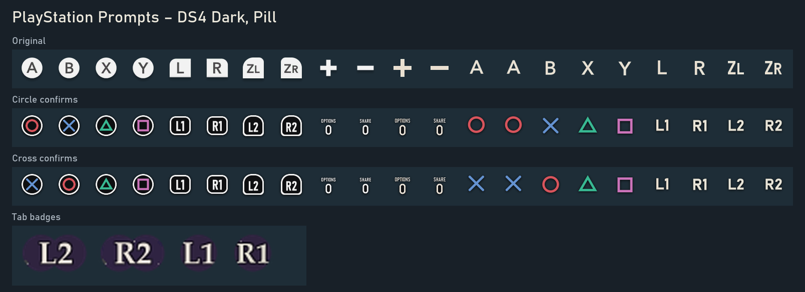
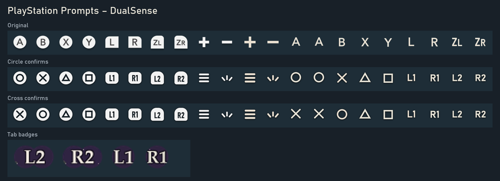
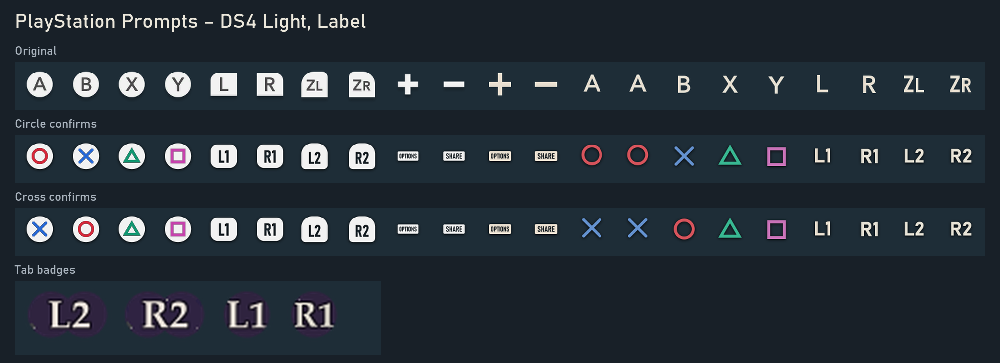
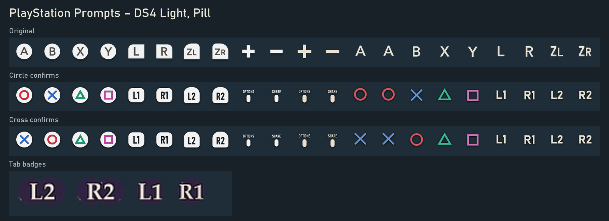

# Fire Emblem: Three Houses – PlayStation Button Prompts

Replaces the Nintendo button icons in **Fire Emblem: Three Houses** with PlayStation icons (Cross, Circle, Square, Triangle, L1/R1, L2/R2, Options, Share/Create):

- the prompt bar and menu icons
- the inventory and status tab badges (ZL/ZR/L/R → L2/R2/L1/R1)
- button names in Guide pages, tutorials and help text, in **all 12 game languages**. "Press the A Button" becomes an inline Circle icon, as do "Ａボタン", "A-Knopf", "bouton A", "botón A", "pulsante A", "A 버튼" and "按Ａ鍵".

Made for game version **1.2.0**. Tested on yuzu and Ryujinx.



## Download

Get the ready-made mod from the **[Releases](../../releases/latest)** page: one small `.7z` with all ten versions and an installer.

1. Extract the archive.
2. Run **PS Prompts Installer.bat**.
3. Pick your emulator, a style, and whether Circle or Cross confirms.

The installer finds yuzu, Ryujinx, suyu, Sudachi, Citron and Eden. It also switches styles and removes the mod. Manual installation is covered in the [README that comes with it](release/README.txt).

| Style | |
|---|---|
| DualSense | Pale buttons, symbol cut out; Options / Create icons |
| DS4 Light, Label | Pale buttons, coloured symbols; SHARE / OPTIONS word labels |
| DS4 Light, Pill | Pale buttons, coloured symbols; SHARE / OPTIONS above a small pill button |
| DS4 Dark, Label | Dark buttons with a light rim, coloured symbols; dark L1/R1/L2/R2 |
| DS4 Dark, Pill | The same, with pill-style SHARE / OPTIONS |

**Circle or Cross:** the mod only changes icons, and your emulator's mapping decides which button confirms. Emulators map a PlayStation pad by position, so Circle = A: use the Circle set. If you swapped A and B so Cross confirms, use the Cross set. The two sets differ only in Cross and Circle.

<details><summary>All styles</summary>






</details>

## Build it yourself

This repository holds only the tools. No game files are included, so you build from your own RomFS dump of the game with the 1.2.0 update (in yuzu: right-click the game → Dump RomFS → Full).

Requirements: Windows (lettering uses Bahnschrift and Palatino Linotype from `C:\Windows\Fonts`), Python 3.8+, `pip install -r requirements.txt`, and [7-Zip](https://7-zip.org) for the `.7z`.

```
python tools/build_all.py --romfs "%APPDATA%\yuzu\dump\010055D009F78000\romfs" --out build
```

That builds all ten variants (about 220 MB each) and the release folder and archive. To build one:

```
python tools/build_th.py --romfs <romfs> --layout circle-confirm --style dualshock-dark --menu ds4-pill --out "PS Prompts - DS4 Dark Pill [Circle]" --preview preview.png
```

Layouts: `circle-confirm` (positional) and `cross-swap` (A/B swapped).

## How it works

- `th_archive.py` reads `DATA0.bin`/`DATA1.bin` and the `patchN/INFO0.bin` override lists (288-byte records pointing at `rom:/...` files; compressed entries are zlib chunks).
- The mod adds override records to `patch4/INFO0.bin` (and the count in `INFO2.bin`) that point at its own files under `romfs/mods/ps_ui/`.
- Icons:
  - Entry 72 is the font atlas behind inline button icons.
  - Entries 6026–6037 (one per language) hold the icon sheet (texture 9) and the tab badges (texture 2).
  - They are G1T textures in BC3, stored linearly. `g1t.py` re-encodes only the changed 4×4 blocks.
- Text:
  - `th_text.py` rewrites the "XL" string tables in `msgdata`, `scrdata` and `tuscrdata`, and the per-language battle-tip lists.
  - Button names become the game's own inline-icon code `ESC P <c>`. The codes were read off an in-game test page: `0–3` A B X Y, `B–E` L R ZL ZR, `H`/`I` + −.
  - In the DS4 styles, + and − are written as the words Options and Share, because their icons are unreadable at text size.
- `tools/installer/` is the PowerShell installer shipped in the release.

## Credits

- Idea and approach: [Fire Emblem XBOX UI Project](https://github.com/YamadaAsaemonGurei/Fire-Emblem-XBOX-UI-Project) by YamadaAsaemonGurei.

Unofficial fan modification. Not affiliated with Nintendo, Intelligent Systems, Koei Tecmo or Sony Interactive Entertainment.
